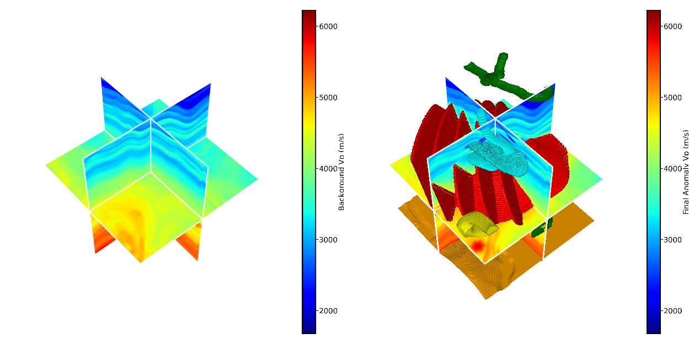

# GEMS-3D

**GEMS-3D** is a curated public release of the GMESDataset codebase for 3D geological multiphysics simulation and benchmark construction. It builds aligned 3D property volumes and forward responses for gravity, magnetic, magnetotelluric, and seismic tasks.

The project is organized for dataset-track review: core geological model generation, reproducible model/forward bundle builders, benchmark datasets, baseline models, and a static project page under `docs/`.



## What Is Included

- Registry-driven 3D geological anomaly generation in `core/anomalies/` and `core/presets.py`.
- Facies-aware multiphysics property construction for `vp`, `rho`, `res`, and `chi`.
- Forward wrappers for gravity, magnetic, MT, and seismic responses.
- Large-scale model and forward-bundle generation scripts.
- Benchmark indexing, dataset loaders, training, evaluation, and metric code under `experiments/`.
- Static project homepage in `docs/index.html`.

Exploratory sample code, local cache data, compiled binaries, debug outputs, and machine-specific batch scripts were intentionally removed from this public tree.

## Repository Layout

```text
GEMS-3D/
  core/                         # anomaly registry, petrophysics, property builders
  Gravity/forward_modeling/      # gravity forward implementation
  Magnetic/forward_modeling/     # magnetic forward implementation
  Electrical/forward_modeling/   # MT forward extension sources and Python wrapper
  Seismic/forward_modeling/      # Deepwave-based seismic forward utilities
  experiments/                   # benchmark datasets, baselines, training/eval scripts
  configs/                       # anomaly and randomization presets
  docs/                          # static project page for GitHub Pages
  data/                          # local input data placeholder, ignored by git
  outputs/                       # generated bundles and reports, ignored by git
```

## Installation

Use Python 3.10 or newer. A CUDA-enabled PyTorch environment is recommended for the heavier forward and benchmark runs.

```bash
cd GEMS-3D
python -m pip install -e ".[dev]"
```

Optional components:

```bash
python -m pip install -e ".[seismic,visualization]"
```

The MT extension under `Electrical/forward_modeling/` contains C++/CUDA sources. Build it only when you need full MT forward modeling; model generation and the gravity/magnetic/seismic benchmark code can be inspected without compiling the extension.

## Build Multiphysics Models

Prepare local velocity volumes under `data/background_velocity/`, optionally mirrored label/sample files under `data/samples/`, then run:

```bash
python build_pretraining_dataset.py \
  --velocity-root data/background_velocity \
  --sample-root data/samples \
  --output-root outputs/PretrainDataset \
  --stage models \
  --anomaly-types igneous_swarm massive_sulfide salt_dome \
  --resume
```

Each generated case writes a `model_bundle.npz` containing aligned `vp_model`, `rho_model`, `res_model`, `chi_model`, metadata, and anomaly labels.

## Run Forward Modeling

For a single SEGY background:

```bash
python run_multiphysics_forward.py \
  --vp_segy data/examples/vp.sgy \
  --label_segy data/examples/label.sgy \
  --save_dir outputs/ForwardOutput \
  --anomaly-type massive_sulfide \
  --seismic-preset light
```

For previously generated model bundles:

```bash
python run_pretraining_forward_from_models.py \
  --model-root outputs/PretrainDataset \
  --resume \
  --skip_seismic
```

The forward-bundle schema is documented in [`README_FORWARD_OUTPUTS.md`](README_FORWARD_OUTPUTS.md).

## Benchmark Code

The benchmark utilities live under `experiments/`.

```bash
python experiments/audit_dataset.py --root outputs/PretrainDataset_forward
python experiments/train_classification.py --root outputs/PretrainDataset_forward
python experiments/train_forward_surrogate.py --root outputs/PretrainDataset_forward
```

Current benchmark scope:

- Forward surrogates: `rho -> gravity`, `chi -> magnetic`, `res -> MT`, `vp -> seismic`, and joint four-property input.
- Inverse interpretation: anomaly-family classification.
- Robustness evaluation: missing-modality and modality-shuffle controls.

## Project Page

Open the static homepage locally:

```bash
python -m http.server 8000 -d docs
```

Then visit `http://localhost:8000`.

For GitHub Pages, publish the `docs/` directory.

## Release Notes

This repository is ready as a public-code staging tree. Before an official release:

- Replace provisional URLs in `pyproject.toml` and `CITATION.cff` if the final repository lives elsewhere.
